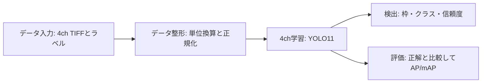

# hpc_rgbd

RGBの3chとDepthの1chを使う、シンプルなYOLO11の4ch学習・検出です。

**意図的にRGB/Depthをゼロにする処理、モダリティ欠落、欠損補完はありません。** 深度は単位換算と線形正規化のみ。元データの0値はそのまま扱います。

## 最初に試す

リポジトリのルートで、準備済みのPython環境から実行します。

```sh
python -m rgbd_yolo demo
```

このPCでは隣の `YOLORGBD/datasets/sunrgbd_top5` を自動検出します。それ以外の環境ではデータの場所を指定してください。

```sh
python -m rgbd_yolo demo --source /path/to/sunrgbd_top5 --output work/my_demo
```

学習8枚・検証4枚をコピーし、入力確認→整形→2 epoch学習→検出→評価まで実行します。結果は `work/my_demo/REPORT.md`。既存の結果を上書きしないため、再実行時は別の `--output` を指定します。画像のダウンロードは行いません。

## 処理の流れ



| 段階 | コマンド | 確認するもの |
|---|---|---|
| 入力・整形 | `prepare` | 画像とラベルの対応、形状、RGB＋正解枠と深度のpreview.jpg |
| 学習 | `train` | 4chの入力、損失、best.pt/last.pt |
| 検出 | `predict` | prediction.jpgとdetections.json |
| 評価 | `val` | クラス別AP、mAP、metrics.json |
| 一通り実行 | `demo` | 上記を順に実行しREPORT.mdを作成 |

具体的な手順は [docs/WORKFLOW.md](docs/WORKFLOW.md)、引継ぎは [HANDOVER.md](HANDOVER.md)、残した機能は [docs/FEATURES.md](docs/FEATURES.md) にあります。

## 個別に使う

```sh
python -m rgbd_yolo prepare --source /path/to/sunrgbd_top5 --output work/subset
python -m rgbd_yolo train --data work/subset/data.yaml --config work/subset/preprocess.yaml --epochs 2 --imgsz 160 --batch 2 --name quick --no-plots
python -m rgbd_yolo predict --model runs/quick/weights/best.pt --images work/subset/images/val --imgsz 160 --output work/detections
python -m rgbd_yolo val --model runs/quick/weights/best.pt --data work/subset/data.yaml --imgsz 160 --output work/evaluation
```

`predict --image` で1枚、`--images` でフォルダを処理できます。位置合わせ済みRGB＋深度PNGのペア入力も `--rgb` と `--depth` で使用できます。深度PNGはmm単位です。

## 入力の前提

- RGBと深度は画素対応済み。センサ機種は不明で、RealSenseとは断定していません。再投影や校正は行いません。
- 今回確認した4ch TIFFの保存形式は、RGB保存値÷256、Depth保存値÷8でmmへ戻す設定です。深度上限8000mmで0～1へ線形正規化します。
- 保存値がすでに8bit強度・深度mmのTIFFは `configs/aligned_mm_tiff.yaml`。保存形式に応じて設定を選びます。
- 同じ画像サイズであることだけでは、物理的な画素対応を証明できません。
- NaN/Infや不足チャンネルはエラーにします。チャンネルや深度を生成して補いません。

## 環境とテスト

確認環境: Python 3.13.14、PyTorch 2.11.0+cpu、Ultralytics 8.4.31、OpenCV 4.13.0.92。

ホストに合うPyTorchを用意した環境で `python -m pip install -r requirements.txt`。リポジトリ内からの実行にはパッケージのインストールは不要です。

```sh
python -m unittest discover -s tests -v
python scripts/smoke_test.py --source /path/to/sunrgbd_top5
```

詳細は [docs/VALIDATION.md](docs/VALIDATION.md)。少量テストは動作確認で、精度の優位性は判断しません。

## 構成

- `rgbd_yolo/`: 入力整形、学習、検出、評価、デモ
- `configs/`: 保存形式別の単位設定
- `scripts/`: 学習確認テスト、HPCのPBS入口
- `tests/`: 前処理・入力検証・座標変換のテスト
- `legacy/`: 旧77ファイルを保存。現在の学習経路では読み込みません
- `work/`, `runs/`: ローカルのデータと結果。Git対象外

旧ファイルの保存先は [docs/FILE_MAP.md](docs/FILE_MAP.md)。実データ全体はGitからは取得できないため、別途用意します。
