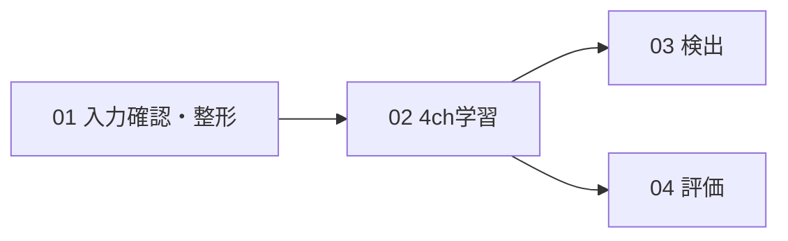

# hpc_rgbd — RGB＋深度の4ch学習

**番号順に4つのPythonファイルを実行します。設定は `settings.yaml` の1か所です。**

```sh
python 01_prepare_data.py
python 02_train_model.py
python 03_detect_objects.py
python 04_evaluate_model.py
```

最初はSUN RGB-Dの学習8枚・検証4枚、160px、2 epochで試す設定です。このPCでは既存の隣の `YOLORGBD/datasets/sunrgbd_top5` を入力元として探します。他の環境では `settings.yaml` の `source_dataset` にデータの場所を指定してください。画像のダウンロードは行いません。

## 各ファイルの役割

| 順番 | Pythonファイル | 行うこと | 主な出力 |
|---|---|---|---|
| 01 | 01_prepare_data.py | 入力画像・ラベルの確認、部分抽出、整形の確認 | data.yaml、preview.jpg、input_report.json |
| 02 | 02_train_model.py | YOLO11nの4ch学習 | best.pt、last.pt、results.csv |
| 03 | 03_detect_objects.py | 検証画像フォルダを一括検出 | 枠付き画像、detections.json、index.json |
| 04 | 04_evaluate_model.py | 正解ラベルと比較して評価 | metrics.json、クラス別SUMMARY.md |

01は入力確認とデータ整形をまとめた段階です。02以降は必要な段階だけ再実行できます。03は正解ラベルを使用せず予測し、04は正解ラベルとの比較で精度を計算します。



## 設定する場所

`settings.yaml` の主な項目を変更します。相対パスはsettings.yamlの場所を基準にします。

| 項目 | 意味 | 初期値 |
|---|---|---|
| source_dataset | 元の4chデータのフォルダ | null＝このPCの既存データを探す |
| train_count / val_count | 取り出す画像枚数 | 8 / 4 |
| epochs | 学習回数 | 2 |
| image_size | 入力サイズ | 160 |
| batch_size | バッチサイズ | 2 |
| device | 実行する装置 | cpu |
| training_directory | 学習結果の保存先 | runs/quickstart |
| model_file | 検出・評価する重み | null＝上の学習のbest.pt |

通常の本学習では画像枚数、epochs、image_sizeなどを変更します。GPUを使う場合は対応するPyTorch環境を用意し、deviceを `"0"` にします。まずローカルテストで入力を確認してください。

別設定も使用できます。

```sh
python 02_train_model.py --settings my_settings.yaml
```

01を再実行した場合、設定と画像・ラベルが一致すれば整形済みデータを再利用します。設定や入力が変わった場合は `data_directory` を別の場所へ変更してください。学習・検出・評価の同じ出力先は再利用するので、以前の実験を残す場合は各directory設定を変更します。

## 入力とモデルの前提

- RGBと深度が画素対応済みの4ch TIFFとYOLO形式ラベルを使います。機種は不明で、RealSenseとは断定していません。
- 基本構造は標準YOLO11n。入力Convを4chにし、データYAMLで `channels: 4` を指定します。
- 入力はB,G,R,Dの順。単位換算と線形正規化だけを行います。ゼロ化、モダリティ欠落、欠損補完はありません。
- 今回のTIFFではRGB保存値÷256、深度保存値÷8でmmへ戻します。保存形式が違う場合はconfigs内の設定を合わせてください。

詳細: [処理手順](docs/WORKFLOW.md) · [YOLOの構造](docs/ARCHITECTURE.md) · [引継ぎ](HANDOVER.md) · [検証結果](docs/VALIDATION.md)

## フォルダ構成

```text
01_prepare_data.py       入力・整形
02_train_model.py        学習
03_detect_objects.py     検出
04_evaluate_model.py     評価
settings.yaml           共通設定
configs/                クラス名、保存倍率、深度上限
weights/                現在使うYOLO11nの初期重み
rgbd_yolo/              各段階の内部処理
datasets/rgb_reference/ 元から入っていたRGB比較用データ
scripts/                HPC入口と詳細な動作確認テスト
docs/                   説明資料
legacy/                 過去の実験、旧入口、旧モデルなど
work/quickstart/         準備データ、検出・評価結果（Git対象外）
runs/quickstart/         学習結果（Git対象外）
```

過去のファイルは削除せず、普段使わないものをlegacyへ移しています。配置変更は [docs/FILE_LAYOUT.md](docs/FILE_LAYOUT.md) を参照してください。

## 環境・その他の機能

確認環境はPython 3.13.14、PyTorch 2.11.0+cpu、Ultralytics 8.4.31。ホストに適したPyTorchを用意し、`python -m pip install -r requirements.txt` を実行します。CPUの確認用構成はrequirements/cpu.txtです。

RGB比較、1枚／ペア入力の検出、一括デモ、HPC、深度への勾配確認も残しています。[docs/FEATURES.md](docs/FEATURES.md) を参照してください。
