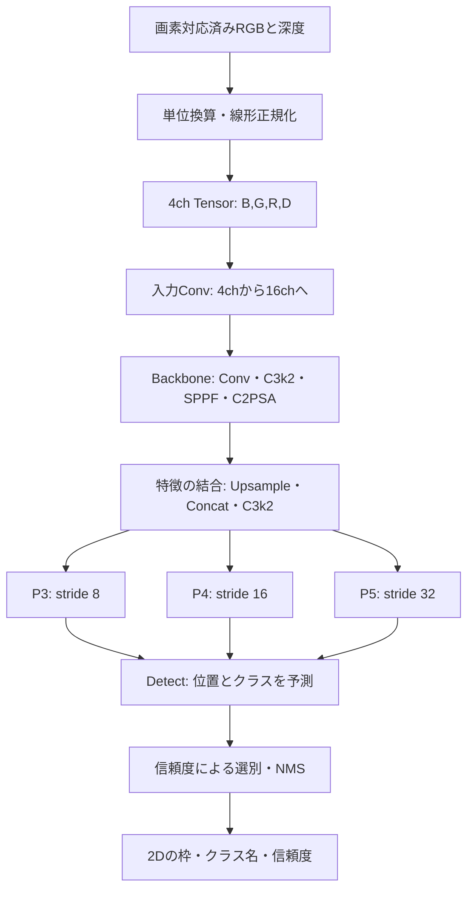

# YOLOのアーキテクチャと4ch入力

このリポジトリは **YOLO11nの物体検出モデルを、RGB＋深度の4ch入力で学習する構成** です。通常のYOLO11nと同じ特徴抽出・検出処理を使い、入力を受ける最初の畳み込み層を3chから4chへ変更しています。

説明の基準は、実行確認に使用したUltralytics 8.4.31、`yolo11n.yaml`、SUN RGB-D Top5の5クラスです。`--cfg` やクラス数を変更すると、構造やパラメータ数も変わります。

## 全体像



RGBと深度を入力の時点で結合する **early fusion（入力段階での融合）** です。RGB用・深度用に別々のネットワークを持つ構造ではありません。最初の層から、色と深度を合わせた特徴を学習します。

## 1. 入力は何か

1画素につき、色の3値と深度の1値を渡します。現在の実装ではOpenCVの読み込み順を維持し、**B,G,R,D** の順です。

```text
整形済み画像: [高さ, 幅, 4]
学習・推論:   [バッチ数, 4, 高さ, 幅]
例:           [2, 4, 640, 640]
```

RGB強度と深度をそれぞれ0～1の範囲へ正規化します。深度は設定した最大距離までの線形変換です。人工的にチャンネルをゼロにする処理、欠落条件の生成、欠損補完はありません。元データの深度0値はそのまま扱います。

幾何的な位置合わせは入力前に済んでいることが条件です。ネットワークはRGBと深度の座標ずれを自動で校正するものではありません。詳細は [WORKFLOW.md](WORKFLOW.md) を参照してください。

## 2. Backbone: 画像から特徴を取り出す

Backboneは画像を徐々に小さくしながら、形状や境界、物体を区別する特徴を抽出します。

| 部品 | このモデルでの役割 |
|---|---|
| Conv | 畳み込み・正規化・活性化。stride=2の層では縦横を半分にする |
| C3k2 | 分岐した特徴と畳み込みブロックを組み合わせて特徴を更新する |
| SPPF | 異なる広さの周辺情報をプーリングで集約する |
| C2PSA | 特徴の一部にattentionを適用し、位置間の関係を扱う |

640×640の入力を実際にforwardした際の主な出力形状です。ここではバッチ数を省略しています。

| 層番号 | 処理 | 出力形状 C×H×W | 入力に対する縮小率 |
|---|---|---|---|
| 入力 | B,G,R,D | 4×640×640 | 1 |
| 0 | 最初のConv | 16×320×320 | 2 |
| 2 | C3k2 | 64×160×160 | 4 |
| 4 | C3k2 | 128×80×80 | 8 |
| 6 | C3k2 | 128×40×40 | 16 |
| 8 | C3k2 | 256×20×20 | 32 |
| 9 | SPPF | 256×20×20 | 32 |
| 10 | C2PSA | 256×20×20 | 32 |

`n` はnanoのモデル規模を表します。モデル定義のチャンネル数・繰り返し数には縮小係数が適用されるため、YAMLに書かれた数値と構築後の数値は一致するとは限りません。この表は構築後の実測値です。

## 3. Neck: 大小の特徴を組み合わせる

粗い特徴マップには広い範囲の情報、細かい特徴マップには位置や境界の情報があります。Upsampleで解像度を合わせ、Concatでチャンネル方向に結合し、C3k2で処理します。その後、再び縮小しながら特徴を結合します。

この部分を役割としてNeckと呼んでいます。UltralyticsのYAMLでは、この部分とDetect層がまとめて `head` に記述されています。

最終的にDetectへ渡す特徴は3種類です。

| 出力層 | 名前 | stride | 640入力時の形状 | 160入力時の空間サイズ |
|---|---|---|---|---|
| 16 | P3 | 8 | 64×80×80 | 20×20 |
| 19 | P4 | 16 | 128×40×40 | 10×10 |
| 22 | P5 | 32 | 256×20×20 | 5×5 |

細かいマップと粗いマップを併用することで、大きさの異なる物体に対応します。物体の大きさごとに担当クラスが固定されているわけではありません。

## 4. Detect: 枠とクラスを予測する

23番目のDetect層は、3段階の特徴から物体の位置とクラスのスコアを予測します。今回のクラスはchair、cabinet、picture、books、tableです。

YOLO11のこの検出器はanchor-free方式で、特徴マップ上の基準点から枠を予測します。学習時の枠回帰では、各辺の距離を分布として表現します。今回の `reg_max` は16で、DFLを使って学習します。

640入力では `80×80 + 40×40 + 20×20 = 8400` 箇所から予測します。評価モードでのデコード後・NMS前の出力は、5クラスの場合 `[batch, 9, 8400]` です。9は枠の4値と5クラスのスコアです。これは最終的な検出件数ではありません。

その後、信頼度の低い候補を除き、重なりの大きい候補をNMSで整理します。リポジトリの推論処理は、残った枠をリサイズ・余白追加前の元画像座標に戻し、クラス名と信頼度とともに保存します。

**深度を入力しても、出力は2Dの物体検出です。** 3Dの箱、物体の距離、姿勢を直接出力するモデルではありません。

## 5. 4ch対応で変更している場所

実装は [rgbd_yolo/training.py](../rgbd_yolo/training.py) の `RGBDTrainer.get_model()` です。

```python
model = DetectionModel(cfg, nc=self.data['nc'], ch=4, verbose=verbose)
```

YOLO11nの最初のConvは次のようになります。

```text
通常の3ch: Conv2d(3, 16, kernel_size=3, stride=2, padding=1)
現在の4ch: Conv2d(4, 16, kernel_size=3, stride=2, padding=1)
```

入力チャンネルが1つ増えても、この層の出力は16chのままなので、後続のBackbone・Neck・Detectには通常と同じ形状の特徴を渡せます。モデル全体を4chのまま流し続けるわけではありません。

先頭Convの重み形状は `[16, 4, 3, 3]`。同じ5クラス構成の3chモデルとの差は、この層の144個の重みです。今回の4ch・5クラスモデルのパラメータ数は、層融合前で **2,590,959** でした。

### 事前学習済み重みの使い方

初期重みの既定は `yolo11n.pt` です。

1. 形状の合う重みを読み込む。
2. 入力が3chの重みから移植する場合、先頭Convの最初の3chへ元の重みをコピーする。
3. 新しい深度用の1chには、その3chの重みの平均を入れて初期化する。
4. 学習では、深度に接続する重みも更新する。

RGB重みをそのままコピーしており、この処理でBGR/RGBの並べ替えは行いません。現在の4ch経路では、学習・検出・評価をBGRDで統一しています。別のコードからTensorを渡す場合も順番を合わせてください。

深度用の重みは単なる初期値です。事前に深度の意味を学んでいるわけではありません。また、80クラスから5クラスへ変更する際に形状が合わない出力部分は、同じ形でそのまま移植できません。

## 6. 学習と評価で見る値

学習ではUltralyticsの検出損失を使用します。

| 損失 | 意味 |
|---|---|
| box_loss | 正解の枠に位置・大きさを近づける |
| cls_loss | 正しいクラスのスコアを上げる |
| dfl_loss | 枠の辺までの距離の分布を学習する |

損失は学習中の指標です。最終的な検出性能は検証用データでPrecision、Recall、AP、mAPを計算して確認します。4ch入力を受け取れること、深度用重みが更新されること、RGBだけより精度が上がることは、別々の確認項目です。

## 7. 構造を手元で確認する

```sh
python -c "from ultralytics.nn.tasks import DetectionModel; m=DetectionModel('yolo11n.yaml', ch=4, nc=5); print(m.model[0].conv); print(m.stride)"
```

この資料の形状とパラメータ数は、構築したモデルへ `[1,4,640,640]` のTensorを実際に通して確認しました。基盤の定義は、インストールしたUltralytics内の `ultralytics/cfg/models/11/yolo11.yaml` にあります。独自部分は [training.py](../rgbd_yolo/training.py)、入力は [preprocessing.py](../rgbd_yolo/preprocessing.py)、検出結果の座標復元は [inference.py](../rgbd_yolo/inference.py) を参照してください。
